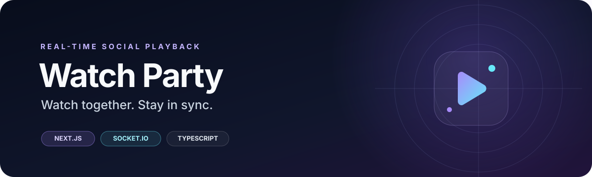

# Watch Party

<p align="center">
  
</p>

<p align="center">
  <strong>Watch together. Stay in sync.</strong><br />
  A real-time watch-party web app with shared playback, live chat, reactions, playlists, polls, and room invites.
</p>

<p align="center">
  <a href="https://github.com/vedantbhattt/watch-party"></a>
  
  
  
</p>

---

## Overview

Watch Party lets people join a shared room and coordinate playback while chatting and interacting. Rooms can be shared through an invite URL or a short room code. The server is authoritative for room playback state, while connected clients receive real-time updates over Socket.IO.

> **Project status:** Active prototype. Automated tests cover important server and application behavior, but real-browser and separate-machine network performance targets still require manual verification. See [Testing & Requirements](./TESTING-AND-REQUIREMENTS.md).

## Features

| Area | Capabilities |
| --- | --- |
| **Rooms & invites** | Create or join a room using an invite URL or six-character code |
| **Synchronized playback** | Shared play, pause, seek, relative skips, and restart controls |
| **Drift correction** | Clock-offset estimation and periodic playback-position checks |
| **Live interaction** | Room chat and stacked, temporary emoji reactions |
| **Shared playlist** | Add supported links, load queued media, and remove eligible items |
| **Group polls** | Create polls, vote live, view totals, and close polls |
| **Host management** | Transfer host privileges or automatically promote another participant after disconnect |
| **Movie discovery** | Browse a curated catalogue with category/decade filters and typo-tolerant search |
| **Resilience & validation** | Validated payloads, rate limits, reconnect grace, and duplicate playlist URL prevention |

## Tech stack

- **Application:** Next.js, React, TypeScript
- **Real-time communication:** Socket.IO
- **Styling:** Tailwind CSS
- **Quality checks:** ESLint, TypeScript, Node test runner via `tsx`

See [package.json](./package.json) for the exact dependency versions and available scripts.

## Getting started

### Prerequisites

- Node.js compatible with the dependencies in `package.json`
- npm

### Install and run

**Windows PowerShell**

```powershell
npm.cmd ci
npm.cmd run dev
```

**macOS / Linux**

```bash
npm ci
npm run dev
```

Open [http://localhost:3000](http://localhost:3000) in your browser. Stop the development server with `Ctrl+C`.

### Verify the project

Run these commands from the repository root:

```bash
npm run lint
npm run typecheck
npm test
npm run build
```

Or run the combined lint, type-check, and test suite:

```bash
npm run check
```

The tests exercise validation, search, and real-time server behavior. A localhost playback-propagation smoke test is useful for regression checks, but it is **not** proof of latency on a separate-machine LAN or of end-to-end video-frame synchronization.

## How it works

1. A participant creates a room or joins through an invite/code.
2. The server maintains the room's current state and validates incoming actions.
3. Socket.IO broadcasts accepted state changes to connected participants.
4. Clients synchronize their player position against the shared room clock and apply corrections when estimated drift exceeds the configured threshold.
5. Room features such as chat, reactions, playlist changes, polls, and host transfer use real-time events.

**Current architecture at a glance**

```text
Browser clients
      |
      | Socket.IO events
      v
TypeScript server (server.ts)
      |
      +-- Room and playback state (in memory)
      +-- Validation and host permissions
      +-- Chat, reactions, playlist and polls
      |
      v
Connected room participants
```

## Media support and limitations

- Supported sources include embeddable YouTube videos and direct browser-playable HTTP(S) media files, typically MP4 or WebM.
- A normal webpage URL is not necessarily a playable media file.
- Protected streaming services and DRM-restricted content are not supported; the application does not bypass subscriptions, paywalls, DRM, or provider restrictions.
- YouTube chooses playback quality separately for each viewer. Identical resolution, FPS, or displayed frames across devices cannot be guaranteed.
- Browser autoplay rules may require a participant to interact with the player before playback begins.
- Room state is held in memory and resets when the server restarts or a room empties. Multi-instance deployment would require shared state and a Socket.IO adapter.

## Testing and performance transparency

The automated smoke test connects ten Socket.IO clients to a single local server process and measures playback-control event propagation over loopback. It checks a p95 threshold for that test environment.

This measurement does **not** include separate-machine LAN latency, browser rendering, media decoding, buffering, or the exact frame displayed. The stated 250 ms control-propagation and 500 ms post-correction drift targets need separate browser/device verification before they can be claimed as demonstrated.

See [TESTING-AND-REQUIREMENTS.md](./TESTING-AND-REQUIREMENTS.md) for the requirement traceability matrix, test conditions, LAN test procedure, and pending measurement table.

## Project documentation

- [Testing & Requirements](./TESTING-AND-REQUIREMENTS.md) — requirements, test scope, LAN verification steps, and known gaps
- [Verification Report](./VERIFICATION-REPORT.md) — verification notes
- [Playback Sync Upgrade](./PLAYBACK-SYNC-UPGRADE.md) — synchronization design notes
- [Playback Loop Quality Fix](./PLAYBACK-LOOP-QUALITY-FIX.md) — playback quality notes
- [Rapid Skip Fix](./PLAYBACK-RAPID-SKIP-FIX.md) — relative-skip handling notes

## Contributing

Issues and focused pull requests are welcome. Before submitting a change, run `npm run check` and `npm run build`, and describe any manual browser or multi-device checks performed.

## License

No license is currently specified. Unless a license is added, permission to reuse, modify, or redistribute this project should not be assumed.
